# Sistem Informasi Gudang Bantuan Bencana (SIGudang)

> **Mini Project 3 — Relational Database + Advanced PHP**  
> Sistem manajemen persediaan dan logistik kemanusiaan dengan transparansi publik, kontrol akses berbasis peran (RBAC), integritas transaksi atomik database, dan antarmuka modern responsif.

---

## 📋 Daftar Isi
1. [Fitur & 22 Halaman Sistem](#-fitur--22-halaman-sistem)
2. [Teknologi yang Digunakan](#-teknologi-yang-digunakan)
3. [Struktur Database](#-struktur-database)
4. [Akun Pengguna Default](#-akun-pengguna-default)
5. [Panduan Instalasi & Menjalankan](#-panduan-instalasi--menjalankan)
6. [Skenario Pengujian Penting](#-skenario-pengujian-penting)
   - [Pengujian Login & Otorisasi RBAC](#1-pengujian-login--otorisasi-rbac)
   - [Pengujian Transaksi Barang Masuk (Atomik)](#2-pengujian-transaksi-barang-masuk-atomik)
   - [Pengujian Transaksi Barang Keluar & Validasi Stok Tidak Cukup](#3-pengujian-transaksi-barang-keluar--validasi-stok-tidak-cukup)
   - [Pengujian Akses Terlarang Staff ke Halaman Admin (403 Forbidden)](#4-pengujian-akses-terlarang-staff-ke-halaman-admin-403-forbidden)

---

## 🚀 Fitur & Dokumentasi Tangkapan Layar (Screenshots) Seluruh Halaman

Berikut adalah tangkapan layar asli (*live captured*) dan penjelasan fungsional serta teknis untuk seluruh halaman sistem:

---

### 🌐 Bagian A — Portal Publik (Tanpa Autentikasi)

#### 1. Beranda Publik (`index.php`)
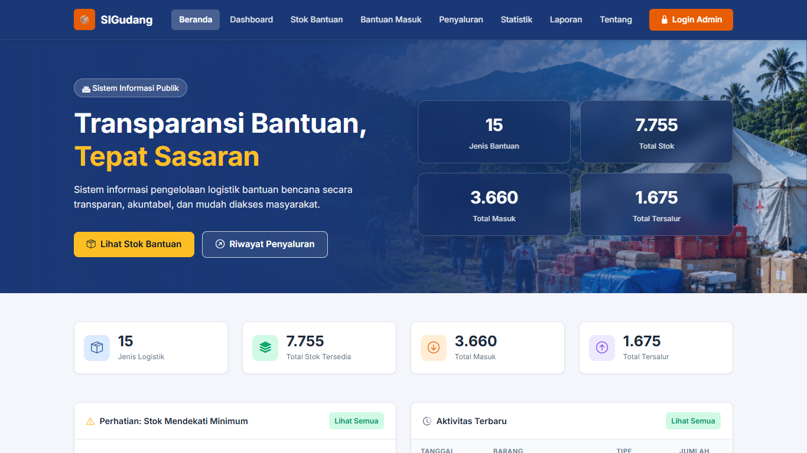
- **Tujuan**: Halaman muka penyambutan masyarakat dan donatur.
- **Fitur Utama**: Hero banner interaktif "Transparansi Bantuan, Tepat Sasaran", 4 kartu ringkasan logistik utama (total jenis logistik, total stok fisik, penerimaan bantuan, dan penyaluran bantuan), alert peringatan dini stok menipis, dan feed riwayat aktivitas publik terkini.
- **Teknis Backend**: Query agregat ringan untuk agregasi stok publik, sanitasi output HTML penuh (`e()`), navigasi responsif Bootstrap 5.

#### 2. Dashboard Publik (`public/dashboard.php`)

- **Tujuan**: Memberikan transparansi visual mengenai posisi logistik kemanusiaan secara komprehensif kepada publik.
- **Fitur Utama**: Grafik perbandingan bulanan barang masuk vs barang keluar berbasis Chart.js, diagram komposisi kategori bantuan, serta metrik ketersediaan barang siap salur.
- **Teknis Backend**: Query SQL `GROUP BY DATE_FORMAT(date, '%Y-%m')` dengan fungsi agregat `SUM(CASE WHEN type='IN'...)` dan JSON serialization aman untuk data chart.

#### 3. Katalog Stok Bantuan Publik (`public/stok.php`)

- **Tujuan**: Memungkinkan masyarakat dan relawan mengecek ketersediaan barang bantuan yang ada di gudang secara real-time.
- **Fitur Utama**: Pencarian instan (nama atau SKU), filter kategori donasi, filter status persediaan (Aman/Kritis), sorting dinamis multi-kolom, dan paginasi halaman.
- **Teknis Backend**: PDO prepared statements dengan kondisi `WHERE` modular, fungsi `getAllowedSort()` untuk mencegah SQL Injection pada sorting, serta kalkulasi limit-offset paginasi.

#### 4. Riwayat Bantuan Masuk Publik (`public/bantuan_masuk.php`)
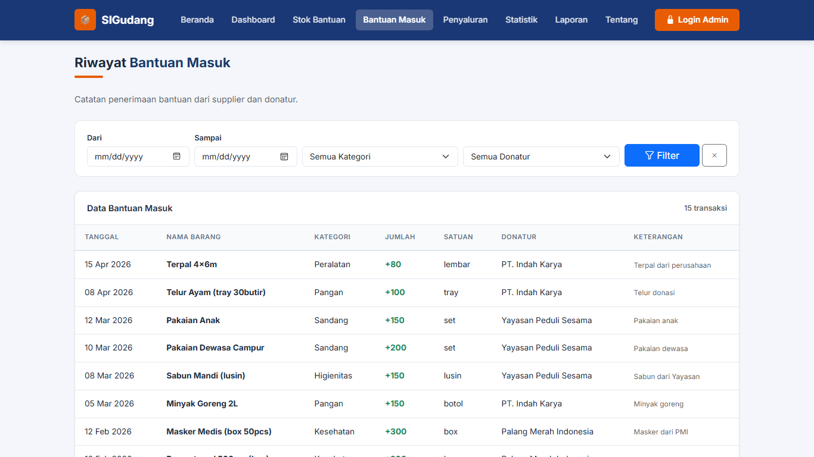
- **Tujuan**: Mempublikasikan catatan donasi yang diterima secara akuntabel kepada masyarakat.
- **Fitur Utama**: Tabel riwayat bantuan masuk publik dengan filter rentang tanggal, pencarian donatur/lembaga, nomor referensi surat jalan, dan jumlah barang.
- **Teknis Backend**: Relasi `JOIN` antara tabel `stock_movements`, `products`, `categories`, dan `suppliers` dengan filter keamanan `sm.is_public = 1`.

#### 5. Riwayat Penyaluran Bantuan Publik (`public/penyaluran.php`)
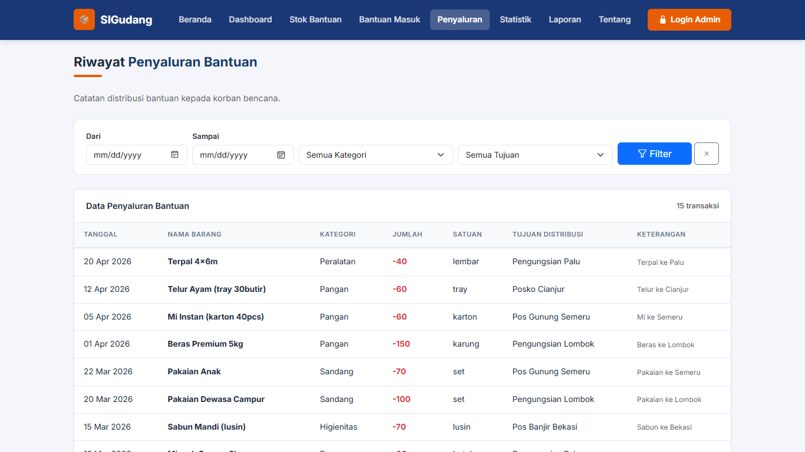
- **Tujuan**: Bukti pertanggungjawaban penyaluran logistik bencana ke posko-posko lapangan.
- **Fitur Utama**: Filter tanggal distribusi, filter lokasi posko penerima, pencarian jenis logistik yang disalurkan, dan nomor dokumen serah terima.
- **Teknis Backend**: Relasi `JOIN` antara `stock_movements`, `products`, dan `distribution_targets` dengan klausa `sm.type = 'OUT'`.

#### 6. Statistik Distribusi Publik (`public/statistik.php`)

- **Tujuan**: Visualisasi analitik persebaran logistik bencana.
- **Fitur Utama**: Grafik distribusi bantuan per wilayah kabupaten/posko titik bencana, rasio barang tersalurkan per kategori, dan metrik persentase pemenuhan kebutuhan.
- **Teknis Backend**: Kueri agregat `COUNT` dan `SUM` dengan agregasi spasial `distribution_targets`.

#### 7. Publikasi Laporan Terbuka (`public/laporan_publik.php`)
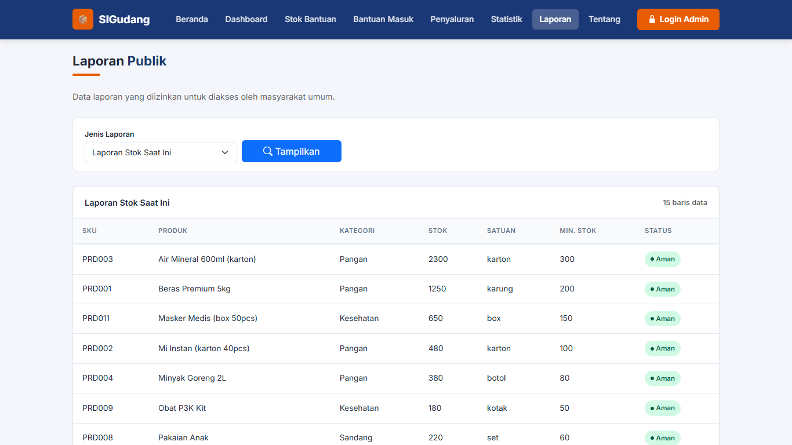
- **Tujuan**: Ringkasan laporan berkala terbuka untuk transparansi audit publik.
- **Fitur Utama**: Rekapitulasi triwulanan/bulanan ketersediaan donasi, laporan arus barang masuk dan keluar, serta tombol cetak ramah printer (*print-friendly*).
- **Teknis Backend**: Rekapitulasi SQL agregat berbasis tanggal.

#### 8. Profil & Tata Kelola Sistem (`public/tentang.php`)
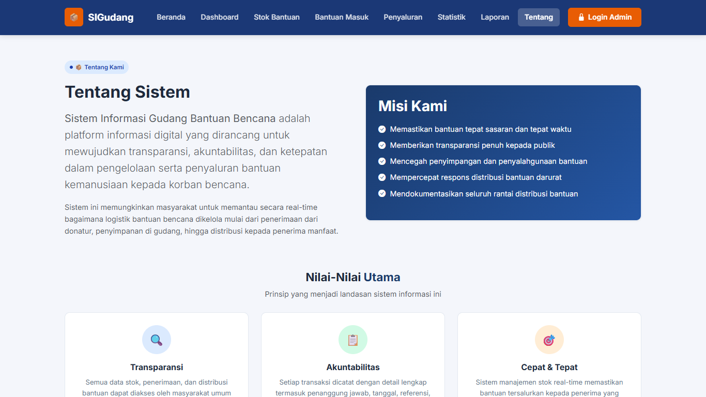
- **Tujuan**: Edukasi publik mengenai mekanisme tata kelola logistik bencana dan kontak darurat posko gudang.
- **Fitur Utama**: Diagram alur rantai pasok donasi (Penerimaan → Verifikasi Gudang → Alokasi Posko), komitmen integritas, dan kontak narahubung BPBD/posko.

---

### 🔐 Bagian B — Modul Autentikasi Multi-Role

#### 9. Halaman Login Sistem (`auth/login.php`)
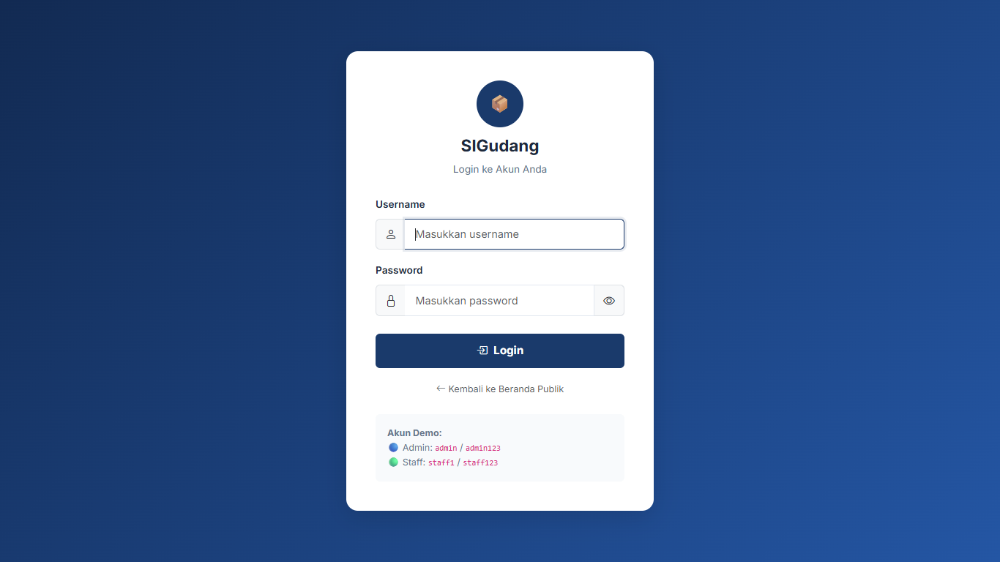
- **Tujuan**: Gerbang masuk autentikasi pengguna dengan hak akses Administrator dan Staff Operasional.
- **Fitur Utama**: Formulir input username & password, show/hide password toggle, pesan kesalahan validasi, info kredensial demo cepat, dan proteksi CSRF.
- **Teknis Backend**: Verifikasi hash kata sandi `password_verify()`, regenerasi identifier sesi `session_regenerate_id(true)` guna menolak serangan *Session Fixation*, dan pengalihan otomatis berdasarkan peran (`role`).

#### 10. Konfirmasi Keluar Sistem (`auth/logout.php`)

- **Tujuan**: Mencegah keluarnya pengguna secara tidak sengaja serta membersihkan sesi secara absolut.
- **Fitur Utama**: Dialog konfirmasi aman dengan token CSRF.
- **Teknis Backend**: Penghapusan array `$_SESSION`, invalidasi cookie sesi browser, eksekusi `session_destroy()`, dan pengalihan ke login dengan pesan notifikasi.

#### 11. Profil Pengguna & Ganti Password (`auth/profil.php`)
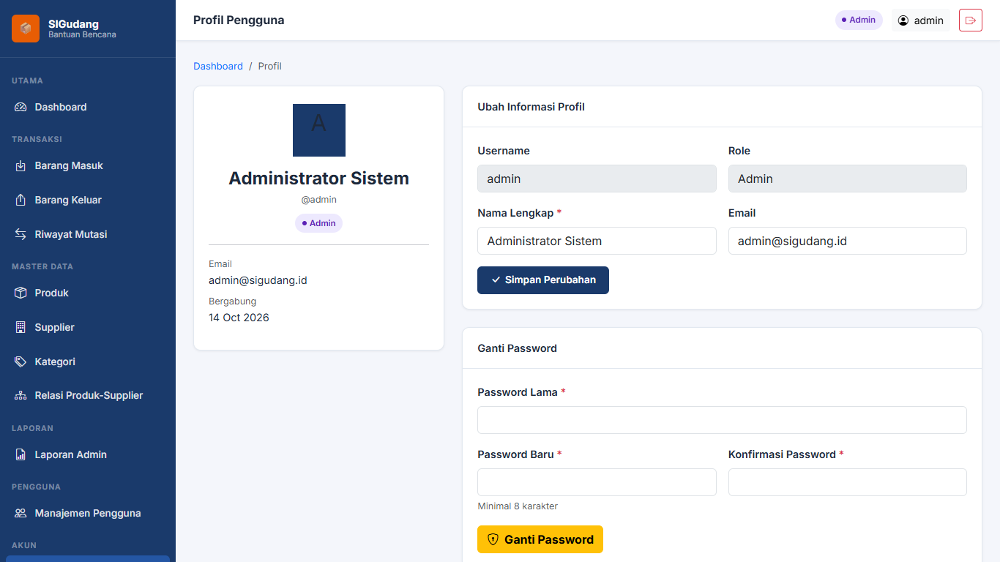
- **Tujuan**: Memungkinkan operator memperbarui identitas dan kata sandi akun masing-masing.
- **Fitur Utama**: Form update nama lengkap dan email, form ubah password dengan validasi password lama, indikator peran pengguna saat ini.
- **Teknis Backend**: Enkripsi password baru menggunakan `password_hash(PASSWORD_BCRYPT)` dengan cost 12.

---

### 🛡️ Bagian C — Administrasi & Master Data (Akses Khusus Administrator)

#### 12. Dashboard Administrator (`admin/dashboard.php`)
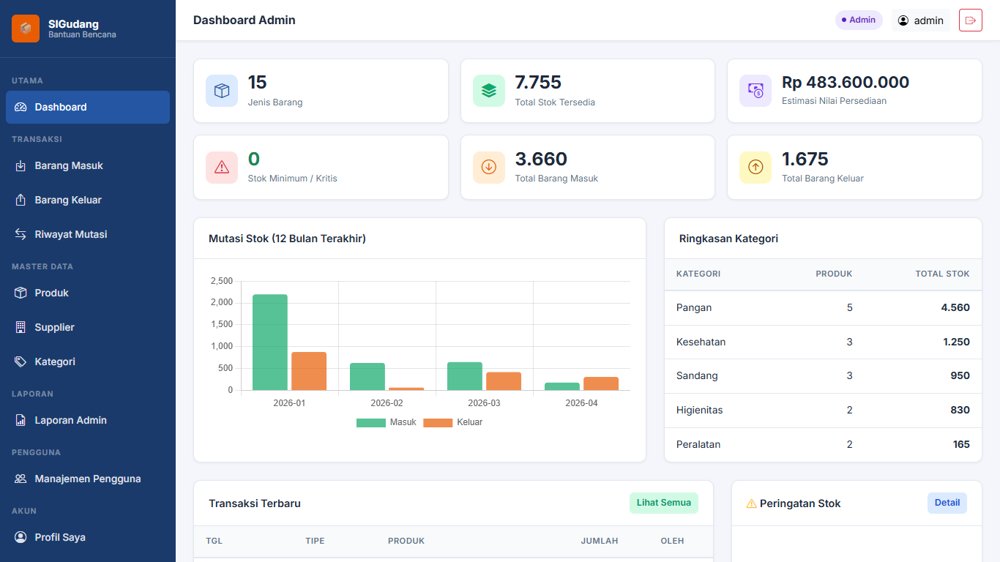
- **Tujuan**: Pusat monitoring menyeluruh inventaris gudang logistik bencana bagi pengambil keputusan.
- **Fitur Utama**: 6 kartu metrik agregat (Total Jenis Logistik, Total Fisik Stok, Estimasi Nilai Persediaan, Stok Kritis/Menipis, Total Penerimaan Masuk, Total Penyaluran Keluar), grafik mutasi bulanan (Chart.js), tabel stok kritis, dan feed transaksi terbaru.
- **Teknis Backend**: Subquery agregat SQL `SELECT (SELECT COUNT(*)...), (SELECT SUM(stock*price)...)` yang dioptimalkan dalam 1 ronde query database.

#### 13. Master Data Produk Logistik (`admin/produk.php`)
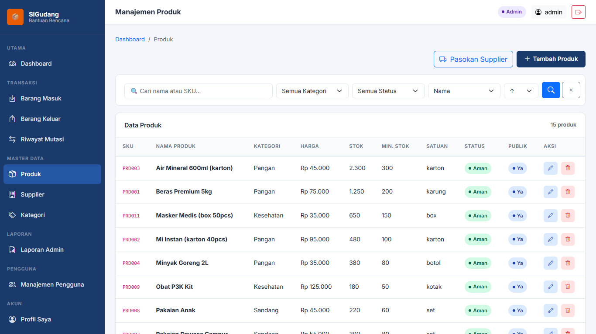
- **Tujuan**: Pengelolaan katalog barang logistik kemanusiaan (pangan, sandang, obat, tenda, higienitas).
- **Fitur Utama**: Modal Tambah/Edit Produk, filter pencarian SKU & nama, filter kategori, badge status stok (Aman / Kritis), pengaturan stok minimum, serta proteksi penghapusan.
- **Teknis Backend**: Constraint `UNIQUE KEY` pada SKU, penanganan duplikasi via `PDOException`, dan verifikasi referensial `SELECT COUNT(*) FROM stock_movements WHERE product_id=?` (produk tidak dapat dihapus jika memiliki riwayat mutasi).

#### 14. Master Data Supplier & Donatur (`admin/supplier.php`)
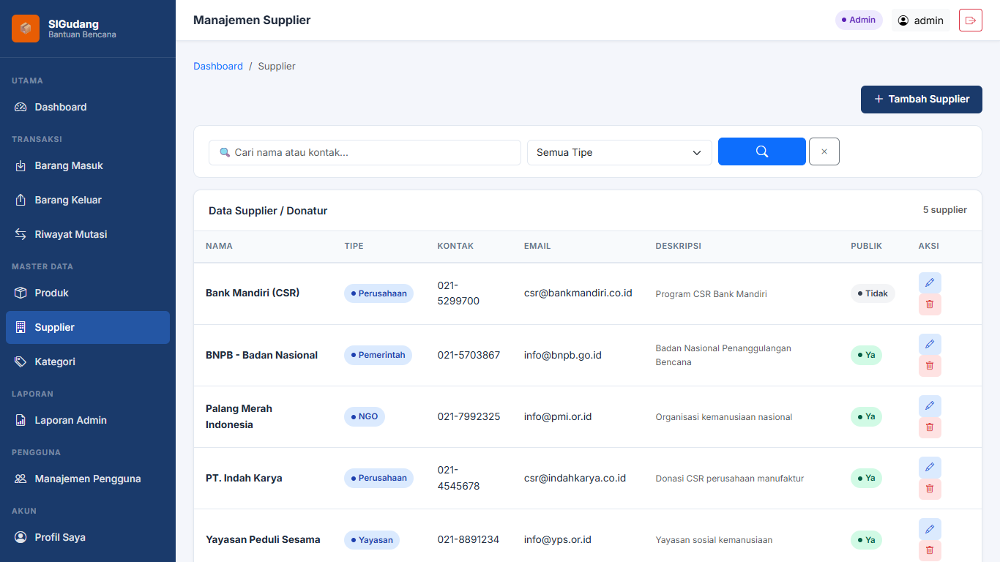
- **Tujuan**: Pengelolaan data lembaga donor, NGO (seperti PMI), instansi pemerintah (BNPB), dan donatur CSR swasta.
- **Fitur Utama**: CRUD data supplier, klasifikasi tipe lembaga, nomor kontak darurat, alamat, dan visibilitas publik.
- **Teknis Backend**: Validasi integritas relasi referensial sebelum aksi hapus supplier.

#### 15. Manajemen Relasi Many-to-Many Produk-Supplier (`admin/produk_supplier.php`)
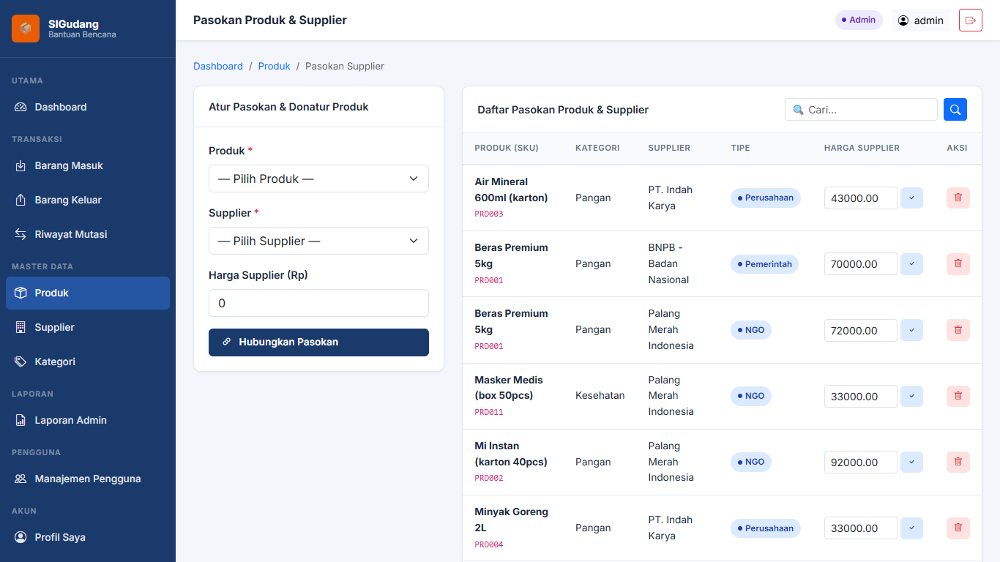
- **Tujuan**: Memetakan hubungan banyak-ke-banyak antara produk bantuan dan para supplier/donatur yang menyediakannya.
- **Fitur Utama**: Penetapan harga referensi per supplier, penambahan relasi baru, pembaruan harga, dan penghapusan relasi.
- **Teknis Backend**: Dikelola melalui tabel perantara (*junction table*) `product_suppliers` dengan *Composite Primary Key* `(product_id, supplier_id)`.

#### 16. Manajemen Kategori Logistik (`admin/kategori.php`)
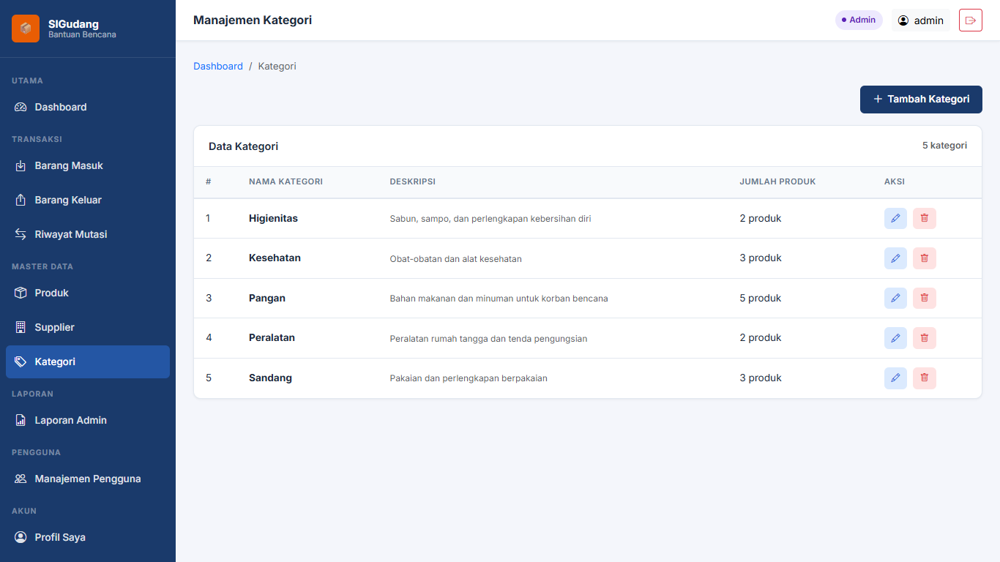
- **Tujuan**: Klasifikasi kelompok barang bantuan (Pangan, Sandang, Kesehatan, Peralatan, Higienitas).
- **Fitur Utama**: CRUD kategori, perhitungan jumlah item terdaftar dalam tiap kategori, dan proteksi integritas.
- **Teknis Backend**: Foreign key `ON DELETE RESTRICT` pada `products.category_id`.

#### 17. Laporan Agregat SQL & Cetak (`admin/laporan.php`)
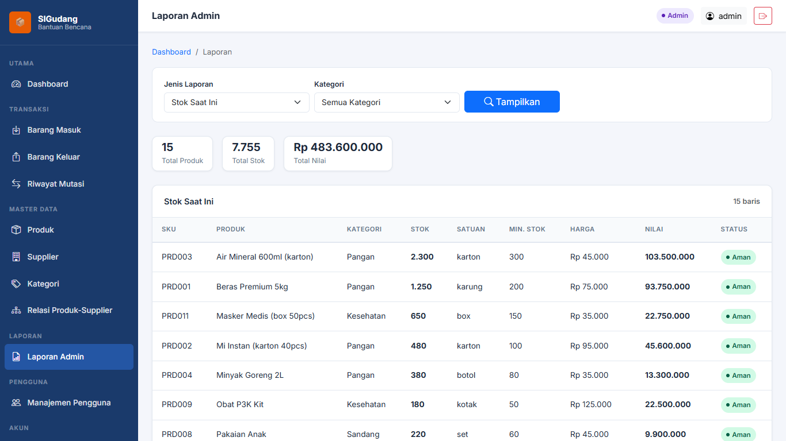
- **Tujuan**: Pembuatan laporan inventaris mendalam untuk pertanggungjawaban audit internal dan BNPB.
- **Fitur Utama**: 8 opsi tipe laporan (Stok Saat Ini, Stok per Kategori, Barang Masuk, Barang Keluar, Mutasi Stok, Distribusi per Tujuan, Nilai Persediaan, Aktivitas Pengguna), filter rentang tanggal, ringkasan kalkulasi otomatis, dan tombol Cetak (*Print*).
- **Teknis Backend**: Menggunakan query agregasi tingkat lanjut dengan `JOIN`, `GROUP BY`, `SUM`, `COUNT`, `HAVING`, dan `CASE WHEN`.

#### 18. Manajemen Pengguna Sistem (`admin/pengguna.php`)
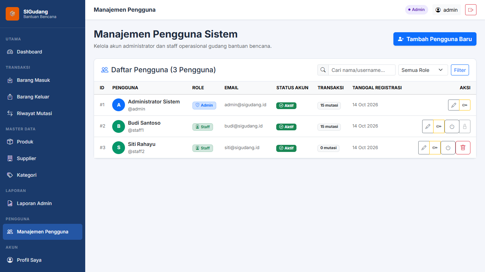
- **Tujuan**: Administrasi akun operator sistem dan kontrol hak akses berbasis peran (RBAC).
- **Fitur Utama**: Tambah user baru, pengubahan role (Admin / Staff), reset password operator, toggle status aktif/nonaktif akun, serta pencegahan penghapusan akun yang sedang aktif atau memiliki histori transaksi.
- **Teknis Backend**: Hashing otomatis via `PASSWORD_BCRYPT`, proteksi ganda server-side `requireAdmin()`.

---

### 📦 Bagian D — Transaksi Gudang Logistik (Admin & Staff)

#### 19. Transaksi Barang Masuk / Donasi Diterima (`admin/barang_masuk.php`)
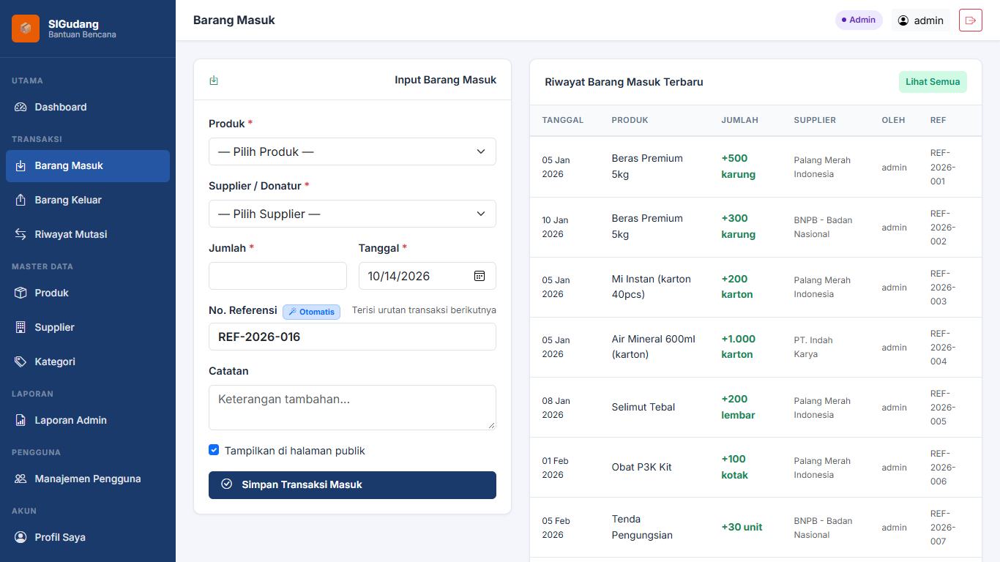
- **Tujuan**: Pencatatan resmi penerimaan logistik bantuan dari donatur ke dalam gudang.
- **Fitur Utama**: Form pemilihan produk, pemilihan supplier/donatur, input jumlah barang, nomor referensi otomatis (`REF-YYYY-XXX`), tanggal kedatangan, catatan surat jalan, serta tabel 10 transaksi penerimaan terkini.
- **Teknis Backend**: **Transaksi Database Atomik PDO** (`$db->beginTransaction()`). Secara simultan menambah stok barang (`UPDATE products SET stock = stock + ?`) dan menyimpan baris histori ke `stock_movements`. Menerapkan pola *Post-Redirect-Get (PRG)* untuk mencegah submit ganda saat refresh browser.

#### 20. Transaksi Barang Keluar / Penyaluran Posko (`admin/barang_keluar.php`)
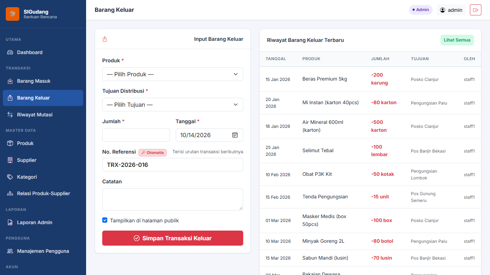
- **Tujuan**: Pencatatan pengeluaran bantuan logistik untuk didistribusikan ke posko pengungsian atau titik bencana.
- **Fitur Utama**: Form pemilihan produk dengan info sisa stok fisik, pemilihan titik posko tujuan distribusi, input kuantitas keluar, nomor referensi pengeluaran (`TRX-YYYY-XXX`), dan tabel riwayat penyaluran terbaru.
- **Teknis Backend**: Menerapkan **Row-Level Locking (`SELECT ... FOR UPDATE`)** dalam transaksi PDO guna mencegah *race condition*. Memvalidasi `stok >= kuantitas` secara ketat; jika stok kurang, transaksi otomatis dibatalkan (`rollBack()`) sehingga stok dijamin **tidak akan pernah bernilai negatif**.

#### 21. Riwayat Mutasi Stok / Audit Trail (`admin/mutasi_stok.php`)
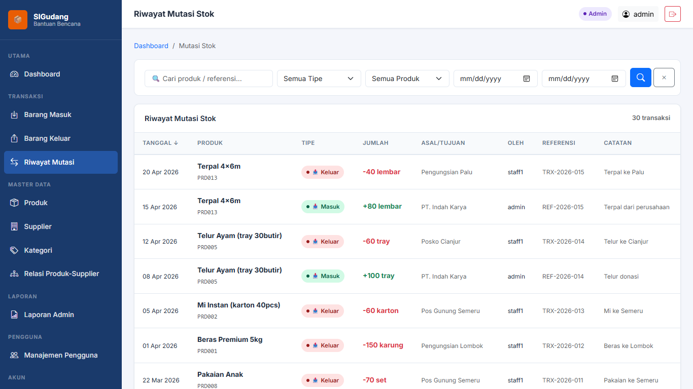
- **Tujuan**: Lembar audit lengkap seluruh mutasi barang masuk dan keluar tanpa ada rekaman yang terlewat.
- **Fitur Utama**: Filter tipe mutasi (IN / OUT), filter rentang tanggal, filter produk, pencarian nomor referensi, sorting dinamis, paginasi, dan badge warna pembeda arah arus logistik.
- **Teknis Backend**: Query multi-table `JOIN` (`stock_movements`, `products`, `users`, `suppliers`, `distribution_targets`) dengan prepared statement dinamis.

---

### 👷 Bagian E — Modul Staff Operasional & Penanganan Error

#### 22. Dashboard Staff Operasional (`staff/dashboard.php`)
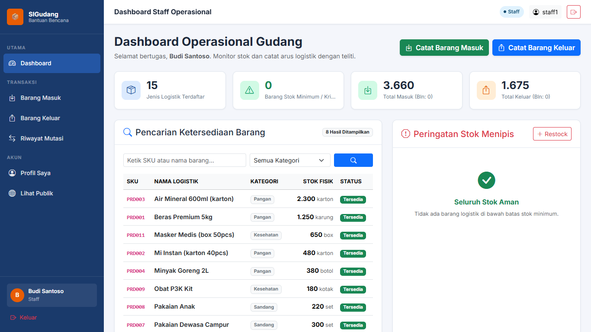
- **Tujuan**: Antarmuka kerja khusus staf logistik lapangan yang ringkas, cepat, dan fokus pada operasional fisik gudang.
- **Fitur Utama**: Akses tombol pintas langsung ke Catat Barang Masuk & Keluar, tabel pencarian cepat ketersediaan barang, metrik ringkas logistik, dan widget pemantau barang menipis. Menu konfigurasi master data dan manajemen user disembunyikan.
- **Teknis Backend**: Otorisasi level staf melalui `requireAdminOrStaff()`.

#### 23. Pengujian Akses Terlarang / HTTP 403 Forbidden (`views/errors/403.php`)

- **Tujuan**: Pembuktian proteksi keamanan server ketika staf mencoba membuka URL terlarang (misal: `/admin/pengguna.php`).
- **Fitur Utama**: Tampilan error profesional dengan status HTTP 403, identitas pengguna yang sedang login beserta rolenya, dan tombol kembali ke dashboard yang sesuai haknya.
- **Teknis Backend**: Dicegat langsung oleh middleware `requireAdmin()` di layer server (bukan sekadar disembunyikan dari menu navigasi).

#### 24. Penanganan Halaman Tidak Ditemukan / HTTP 404 Not Found (`views/errors/404.php`)
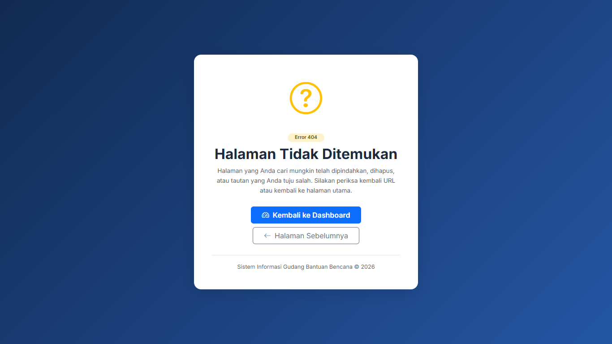
- **Tujuan**: Menangani URL salah atau rute yang tidak terdaftar pada sistem.
- **Fitur Utama**: Informasi ramah pengguna dengan panduan tautan kembali ke Beranda Publik atau Dashboard.
- **Teknis Backend**: Pengembalian kode respons resmi `http_response_code(404)`.

---

## 🛠 Teknologi yang Digunakan

- **Backend**: PHP 8.1+ (Native dengan struktur modular & OOP/prosedural terorganisasi)
- **Database**: MySQL 5.7+ / MariaDB 10.4+ melalui **PHP Data Objects (PDO)**
- **Keamanan**:
  - Prepared Statements pada 100% kueri database (Anti SQL Injection).
  - Enkripsi password menggunakan `password_hash()` algoritma BCRYPT (cost 12).
  - Proteksi Cross-Site Request Forgery (CSRF Token) pada setiap formulir POST.
  - Sanitasi & validasi input serta proteksi XSS menggunakan `htmlspecialchars()`.
  - Middleware otorisasi Role-Based Access Control (`requireAdmin()`, `requireAdminOrStaff()`).
  - Mekanisme transaksi database atomik & row-level locking (`SELECT ... FOR UPDATE`).
- **Frontend**:
  - HTML5 & CSS3 Vanilla kustom (Navy `#1e3a8a`, Amber `#f59e0b`, Emerald `#059669`).
  - Bootstrap 5.3 (Grid responsif & komponen modal/dropdown).
  - Bootstrap Icons 1.11.
  - Chart.js 4.4 (Visualisasi statistik interaktif).

---

## 🗄 Struktur Database & Diagram ERD (Sesuai Ketentuan Pertemuan 4)

Sesuai materi perkuliahan (*Slide 5, 6, 7, 8 Pertemuan 4*), database ini mengimplementasikan ketiga jenis relasi relasional utama:

1. 🟢 **One-to-One (1 : 1)**: `users` ↔ `user_profiles` (FK `user_id` + `UNIQUE`). Memisahkan data login dan profil pengguna.
2. 🔵 **One-to-Many (1 : N)**: `categories` → `products`, `products` → `stock_movements`, `users` → `stock_movements`, dll.
3. 🟣 **Many-to-Many (M : N)**: `products` ↔ `suppliers` melalui tabel perantara (*junction table*) `product_suppliers` dengan *Composite Primary Key* `(product_id, supplier_id)`.

---

### Entity Relationship Diagram (ERD)

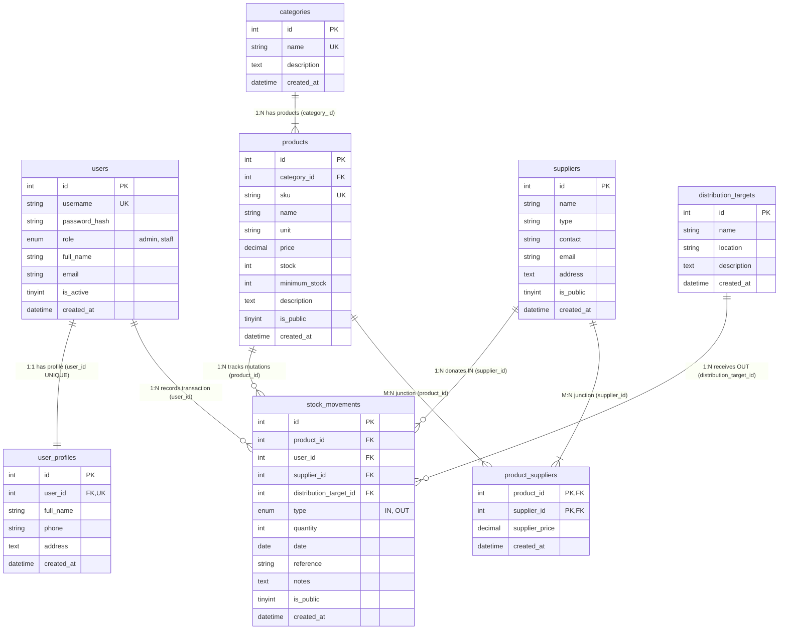

---

### Matriks Relasi Antar Tabel & Integritas Referensial

| Jenis Relasi | Tabel Induk (Parent) | Tabel Anak (Child) | Kolom Penghubung (FK) | Aturan Constraint | Implementasi & Alasan Bisnis |
| :---: | :--- | :--- | :--- | :--- | :--- |
| **One-to-One<br>(1 : 1)** | `users` (`id`) | `user_profiles` (`user_id`) | `user_id` bertipe `UNIQUE` | `ON UPDATE CASCADE`<br>`ON DELETE CASCADE` | Memisahkan data otentikasi login (`username`, `password_hash`, `role`) dengan data profil pribadi (`full_name`, `phone`, `address`). Setiap akun tepat memiliki satu profil. |
| **Many-to-Many<br>(M : N)** | `products` (`id`)<br>`suppliers` (`id`) | `product_suppliers`<br>*(Junction Table)* | Composite PK:<br>`(product_id, supplier_id)` | `ON UPDATE CASCADE`<br>`ON DELETE CASCADE` | Menghubungkan banyak produk dengan banyak supplier donatur sekaligus menyimpan harga referensi pasokan. Pasangan foreign key tidak akan pernah duplikat. |
| **One-to-Many<br>(1 : N)** | `categories` (`id`) | `products` (`category_id`) | `products.category_id` | `ON UPDATE CASCADE`<br>`ON DELETE RESTRICT` | Satu kategori menampung banyak jenis produk. Kategori tidak dapat dihapus jika masih ada produk aktif di dalamnya. |
| **One-to-Many<br>(1 : N)** | `products` (`id`) | `stock_movements` (`product_id`) | `stock_movements.product_id` | `ON UPDATE CASCADE`<br>`ON DELETE RESTRICT` | Satu produk memiliki riwayat transaksi masuk dan keluar. Produk tidak boleh dihapus sembarangan jika memiliki riwayat mutasi. |
| **One-to-Many<br>(1 : N)** | `users` (`id`) | `stock_movements` (`user_id`) | `stock_movements.user_id` | `ON UPDATE CASCADE`<br>`ON DELETE RESTRICT` | Menjamin audit trail: setiap mutasi wajib mencatat operator (admin/staff) yang mengeksekusi transaksi. |
| **One-to-Many<br>(1 : N)** | `suppliers` (`id`) | `stock_movements` (`supplier_id`) | `stock_movements.supplier_id` | `ON UPDATE CASCADE`<br>`ON DELETE SET NULL` | Mencatat asal donatur/supplier pada transaksi `IN`. Bernilai NULL untuk transaksi `OUT`. |
| **One-to-Many<br>(1 : N)** | `distribution_targets` (`id`) | `stock_movements` (`distribution_target_id`) | `stock_movements.distribution_target_id` | `ON UPDATE CASCADE`<br>`ON DELETE SET NULL` | Mencatat posko/titik bencana penerima bantuan pada transaksi `OUT`. Bernilai NULL untuk transaksi `IN`. |

---

## 👤 Akun Pengguna Default

Data seed otomatis menyertakan akun siap pakai untuk demonstrasi:

| Role | Username | Password | Deskripsi |
| :--- | :--- | :--- | :--- |
| **Administrator** | `admin` | `admin123` | Akses penuh ke seluruh menu Master Data, Pengguna, Laporan, & Transaksi |
| **Staff Operasional** | `staff1` | `staff123` | Akses ke Dashboard Operasional & Transaksi Barang Masuk/Keluar/Mutasi |
| **Staff Operasional** | `staff2` | `staff123` | Akun staff lapangan kedua |

---

## ⚙️ Panduan Instalasi & Menjalankan

### Melalui Laragon (Rekomendasi)
1. Buka aplikasi **Laragon** dan klik tombol **Start All** (Apache & MySQL).
2. Pastikan folder proyek berada di direktori `D:\laragon\www\RPL-Pertemuan4`.
3. Buka **HeidiSQL** atau **phpMyAdmin** (`http://localhost/phpmyadmin`).
4. Buat database baru bernama `gudang_bencana`:
   ```sql
   CREATE DATABASE IF NOT EXISTS `gudang_bencana` CHARACTER SET utf8mb4 COLLATE utf8mb4_unicode_ci;
   ```
5. Cukup impor **1 file all-in-one**:
   - Impor berkas: `database/gudang_bencana.sql` (Otomatis membuat database `gudang_bencana`, seluruh 7 tabel, foreign key, dan data seed lengkap).
   - *(Atau alternatif 2 tahap: jalankan `database/schema.sql` lalu `database/seed.sql`)*.
6. Buka peramban (browser) dan akses:
   - **Halaman Publik**: `http://localhost/RPL-Pertemuan4/index.php`
   - **Halaman Login**: `http://localhost/RPL-Pertemuan4/auth/login.php`

---

## 🧪 Skenario Pengujian Penting

### 1. Pengujian Login & Otorisasi RBAC
- Masuk menggunakan akun **Admin** (`admin` / `password`):
  - Sistem mengarahkan langsung ke `/admin/dashboard.php`.
  - Seluruh menu pada sidebar (Utama, Transaksi, Master Data, Laporan, Pengguna) tampil dan dapat diakses.
- Masuk menggunakan akun **Staff** (`staff` / `password`):
  - Sistem mengarahkan ke `/staff/dashboard.php`.
  - Sidebar hanya menampilkan menu Utama (Dashboard Staff) dan Transaksi (Barang Masuk, Barang Keluar, Riwayat Mutasi). Menu Master Data, Laporan, dan Pengguna disembunyikan.

### 2. Pengujian Transaksi Barang Masuk (Atomik)
1. Buka menu **Barang Masuk** (`/admin/barang_masuk.php`).
2. Pilih barang (misal: Beras Premium 5kg, stok awal = 100).
3. Masukkan jumlah penerimaan: `50`, pilih donatur, isi tanggal & referensi surat jalan.
4. Klik **Simpan Transaksi**.
5. Sistem mengeksekusi satu blok transaksi database atomik:
   - `UPDATE products SET stock = stock + 50 WHERE id = ?`
   - `INSERT INTO stock_movements (..., type='IN', quantity=50, ...)`
   - `COMMIT`
6. Stok barang bertambah menjadi `150` dan histori langsung tercatat di Riwayat Mutasi.

### 3. Pengujian Transaksi Barang Keluar & Validasi Stok Tidak Cukup
1. Buka menu **Barang Keluar** (`/admin/barang_keluar.php`).
2. Pilih barang dengan stok terbatas (misal: Obat Antibiotik dengan sisa stok `10`).
3. Masukkan jumlah penyaluran yang melebihi stok: `50`.
4. Pilih lokasi posko bencana dan klik **Simpan Transaksi**.
5. **Hasil yang Terjadi**:
   - Sistem melakukan verifikasi dengan *row-level locking* (`SELECT stock FROM products ... FOR UPDATE`).
   - Karena `quantity (50) > current_stock (10)`, sistem **menolak transaksi** dan memicu `rollBack()`.
   - Muncul notifikasi kesalahan berwarna merah: *"Stok tidak mencukupi! Stok saat ini: 10, jumlah diminta: 50."*
   - Stok barang di database **tetap aman (tidak berubah)** dan **tidak ada mutasi palsu** yang tercatat.

### 4. Pengujian Akses Terlarang Staff ke Halaman Admin (403 Forbidden)
1. Login menggunakan akun Staff (`staff` / `password`).
2. Coba akses langsung tautan khusus admin melalui address bar browser:
   - Buka URL: `http://localhost/RPL-Pertemuan4/admin/pengguna.php` atau `http://localhost/RPL-Pertemuan4/admin/produk.php`.
3. **Hasil yang Terjadi**:
   - Middleware `requireAdmin()` mendeteksi role sesi pengguna adalah `staff`.
   - Server mengembalikan status code `HTTP/1.1 403 Forbidden`.
   - Pengguna diarahkan ke tampilan halaman **Error 403: Akses Terlarang** (`views/errors/403.php`) dengan pesan penolakan dan tombol kembali ke dashboard staff.

---

## 📁 Struktur Berkas Proyek

```
RPL-Pertemuan4/
├── 404.php                     # Handler Error 404 Root
├── index.php                   # Halaman 1: Beranda Publik
├── README.md                   # Dokumentasi Lengkap Proyek
├── admin/                      # Halaman Khusus Administrator & Transaksi
│   ├── barang_keluar.php       # Halaman 15: Transaksi Pengeluaran Bantuan
│   ├── barang_masuk.php        # Halaman 14: Transaksi Penerimaan Bantuan
│   ├── dashboard.php           # Halaman 10: Dashboard Utama Administrator
│   ├── kategori.php            # Manajemen Kategori Logistik
│   ├── laporan.php             # Halaman 18: Laporan Agregat SQL & Cetak
│   ├── mutasi_stok.php         # Halaman 16: Audit Trail Mutasi Logistik
│   ├── pengguna.php            # Halaman 19: Manajemen Pengguna & Reset Password
│   ├── produk.php              # Halaman 11: Master Data Produk Logistik
│   ├── produk_supplier.php     # Halaman 13: Relasi Many-to-Many Produk & Supplier
│   └── supplier.php            # Halaman 12: Master Data Supplier & Donatur
├── assets/                     # Aset Tampilan
│   ├── css/style.css           # Styling Tema Kemanusiaan & Desain Responsif
│   └── js/main.js              # Script Pembantu Frontend & Chart
├── auth/                       # Modul Autentikasi & Akun
│   ├── login.php               # Halaman 9: Login Multi-Role
│   ├── logout.php              # Halaman 22: Logout Aman & Hapus Sesi
│   └── profil.php              # Halaman 20: Profil & Ganti Password
├── config/                     # Konfigurasi Sistem
│   ├── app.php                 # Konstanta Aplikasi & URL
│   └── database.php            # Koneksi PDO Database MySQL
├── database/                   # Skrip Database
│   ├── schema.sql              # Struktur Tabel & Foreign Key
│   └── seed.sql                # Data Awal Lengkap (Seeders)
├── helpers/                    # Fungsi Pembantu Global
│   ├── auth.php                # Helper Sesi, Role, & CSRF Token
│   └── functions.php           # Helper Sanitasi, Format Rupiah/Tanggal, & Flash Message
├── public/                     # Halaman Terbuka untuk Publik
│   ├── bantuan_masuk.php       # Halaman 4: Riwayat Penerimaan Donasi Publik
│   ├── dashboard.php           # Halaman 2: Dashboard Statistik Publik
│   ├── laporan_publik.php      # Halaman 7: Publikasi Laporan Bantuan
│   ├── penyaluran.php          # Halaman 5: Riwayat Penyaluran Bencana Publik
│   ├── statistik.php           # Halaman 6: Grafik Distribusi & Wilayah Bencana
│   ├── stok.php                # Halaman 3: Katalog Ketersediaan Stok Logistik
│   └── tentang.php             # Halaman 8: Profil & Alur Sistem Bantuan
├── staff/                      # Halaman Khusus Staff Operasional
│   └── dashboard.php           # Halaman 17: Dashboard Operasional Lapangan
└── views/                      # Komponen Template & Halaman Error
    ├── errors/
    │   ├── 403.php             # Halaman 21: Tampilan Error 403 Forbidden
    │   └── 404.php             # Halaman 21: Tampilan Error 404 Not Found
    └── partials/
        ├── footer_admin.php    # Footer Internal Dashboard
        ├── footer_public.php   # Footer Portal Publik
        ├── header_admin.php    # Header & Sidebar Navigasi Internal
        └── header_public.php   # Header & Navbar Portal Publik
```

---
*Pengembangan Mini Project 3 — Sistem Informasi Gudang Bantuan Bencana &copy; 2026*
